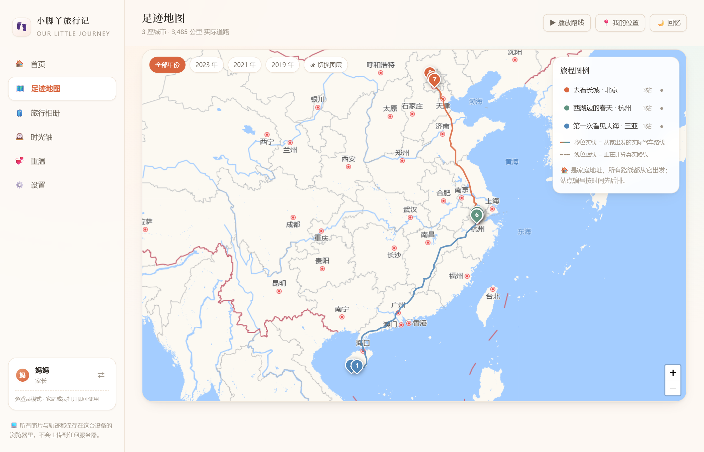

# 👣 小脚丫旅行记

> 一个给自家宝宝做的家庭旅行纪念册。把每一次远行的照片，变成一条能留一辈子的足迹。

等宝宝长大、自己翻到这个页面，能看见自己两岁时站在海边的小小身影；
等父母老了，照着当年的路线再走一遍，在同一个位置拍一张今天的照片 ——
两张照片放在一起，就是时间的样子。

**下载下来双击就能用，不需要安装任何东西。**

```
零依赖 · 零构建 · 打开即用 · 数据全在自己手里 · AGPL-3.0 开源协议
```

---

## 先看两张图



*家里在杭州，三段旅程的**真实驾车路线**：北京、三亚、杭州本地。首页显示累计 3,485 公里 —— 这是沿高速实际跑出来的里程，不是两点之间的直线。*


---

## 30 秒上手

### 🖱️ 方式一：双击，完事（推荐给只想先看看的人）

1. 下载这个项目（绿底 `Code` 按钮 → `Download ZIP`）
2. 解压，双击 `start.bat`（Windows）/ `start.sh`（macOS、Linux）

浏览器会自己打开，然后点「✨ 先看看示例数据」就能立刻看到完整效果。

**装了 Node.js** → 脚本会启动本地服务，数据存进项目的 `data/` 文件夹，手机连同一个 WiFi 也能一起看。

**没装 Node.js 也没关系** → 脚本会直接当普通网页打开，功能一样全：地图、真实道路里程、
照片存储、导出备份全都能用。

> 两种模式的数据是**分开的**：静态模式存在浏览器里，服务模式存在 `data/` 里。
> 看到"有数据却显示不出来"，多半就是模式不对 —— 脚本会提醒你，详见下面的常见问题。

### 🏠 方式二：放在家里的 NAS 上（推荐给要长期用的人）

**前提**：机器上能跑 Node.js（群晖、威联通、绿联、极空间等套件中心或 Docker 都能装）。

```bash
node server.js 5178

# 想把照片存到大容量存储卷（比如 NAS 的某个盘）：
node server.js 5178 --data=/volume1/photos/footprints
```

启动后终端会打印：

```
本机访问：   http://localhost:5178
局域网访问： http://192.168.1.2:5178    ← 手机 / 平板 / 电视盒子用这个
数据目录：   /volume1/small-footprints/data
```

**全家用同一个网址，看到的就是同一份记录**：手机上拍了照上传，客厅电视上就能翻。

> 建议设成开机自启（群晖「任务计划」、systemd 或 Docker 重启策略都行），
> 让它就是家里一个常驻的小站，不用谁记得去启动它。

### 🐳 方式三：Docker

```bash
docker build -t small-footprints .
docker run -d --name small-footprints -p 5178:5178 \
  -v /volume1/photos/footprints:/app/data \
  --restart unless-stopped small-footprints
```

<details>
<summary>Dockerfile</summary>

```dockerfile
FROM node:20-alpine
WORKDIR /app
COPY . .
VOLUME /app/data
EXPOSE 5178
CMD ["node", "server.js", "5178"]
```

</details>

---

## 第一次使用

打开后会先看到欢迎页，三种开始方式：

| 选项 | 什么时候用 |
| --- | --- |
| 👶 **创建我们家的纪念册** | 第一次用。填家庭名称 → 宝宝称呼与生日 → 家里大人的称呼（账号可以跳过） |
| 🔑 **登录已有账号** | 换设备时用。服务端模式输账号密码；本机模式导入之前的备份文件 |
| ✨ **先看看示例数据** | 想先体验。生成一个带 3 段旅程、10 张照片的演示家庭，随时可在设置里清空 |

创建完成后：

1. **先到「设置 → 家庭地址」把家定在地图上**（搜小区名，或直接把地图拖过去）
   —— 定好之后每段旅程都从家出发，里程按**真实驾车道路**计算。
2. 点「＋ 记录一段新旅程」，填标题和日期。
3. 添加站点：点「🗺️ 搜索景点 / 地图选点」，**直接搜景点名**（如「青岛栈桥」）就能定位并自动填好城市；
   也可以搜城市名、在地图上点一下，或者点「📷 用照片里的位置」从带 GPS 的照片里读出位置。
4. 上传照片：自动读取 **拍摄时间** 和 **GPS 拍摄地点**，几乎不用手填。
5. 回「足迹地图」，照片就变成了一条条连起来的路线。

---

## 功能

| 功能 | 说明 |
| --- | --- |
| 🗺️ **足迹地图** | 以「家」为起点，**沿真实道路**画出每段旅程；站点按时间先后全局编号；「播放路线」会开着车沿路走一遍，边走边留轨迹；可按年份筛选、切图层 |
| 🏠 **家庭地址** | 定好家在哪，里程就按「从家出发、沿实际道路行驶」算，而不是两点之间的直线 |
| 🧳 **旅行相册** | 每段旅程是一条站点时间轴：第 1 站、第 2 站……照片分站归档，顺序可调 |
| 🕰️ **时光轴** | 按年份回顾，每段旅程都标注「宝宝几岁几个月」 |
| 💞 **重温模式** | 照着当年的路线再走一遍，新旧照片左右滑动对比，还能一键生成「重温纪念卡」PNG 分享 |
| 👤 **家庭账号** | 爸爸妈妈可编辑，宝宝账号可浏览并写回忆，访客只能看 |

还有：🌙 **回忆模式**（深色，适合安静地翻旧时光）、📸 照片自动压缩、📦 ZIP 一键备份与还原、
⌨️ 手机端底部导航、📲 可添加到主屏（PWA）。

---

## 数据在哪里？

打开页面时程序会先探测有没有服务器，然后**自动二选一**，同一份代码两种方式都能跑。

### 🌐 服务端模式 —— 用 `node server.js` 启动时

数据存在**服务器磁盘**上：

```
data/
├── db.json          家庭、行程、重温记录
└── photos/*.jpg     照片原图与缩略图
```

手机、平板、电脑打开同一个网址看到的**是同一份记录**，换设备不用导入任何东西。

### 💻 本机模式 —— 双击 `index.html`、或部署成纯静态网站时

数据存在**这台设备的浏览器**里（IndexedDB），不共享、不上传。

实测（Edge / Chrome）：双击打开时 IndexedDB、照片存储、Canvas 合成、**真实道路路径规划**全部可用，
和跑服务器相比只是少了「多设备同步」。

⚠️ **两种模式都建议定期备份**：设置 → 数据与备份 → **⬇ 导出备份**，会生成一个 `.zip`
（内含 `data.json` 和 `photos/`）。换设备或误删时用「⬆ 导入备份」完整恢复。
服务端模式下也可以直接备份 `data/` 整个文件夹。

---

## 账号与访问控制

**默认免登录。** 家人打开网址直接进，不用注册、不用记密码 —— 这是给内网自用做的取舍：
能碰到这个网址的人，本来就已经在你家里了。

那「是谁在记录」怎么办？侧边栏底部有个**使用者切换**（不需要密码），点一下就能换人：

- 新加的行程、上传的照片会记在这个名字下
- 切到宝宝身份，界面自动变**只读**，适合让小朋友自己安静地翻，不会误删

### 什么时候该打开登录保护

> 设置 → 访问方式 → **开启登录保护**

**只要把网址暴露出了家庭网络**（内网穿透、公网端口映射、DDNS、把链接发给外地亲友），就请打开它。
否则任何拿到网址的人都能查看、修改、删除全家的照片。

打开后：进入网站需要先选择成员，设了密码的要输密码。建议同时给每个成员都补一个账号密码。

---

## 隐私

- **不用联网也能用**：除了地图瓦片和在线地点搜索，其余功能完全离线。
- **没有第三方**：没有统计、没有埋点、没有云同步。照片只存在你自己的磁盘或浏览器里。
- **唯一的外发请求**是：① 地图瓦片（高德 / OSM）；② 地点搜索；③ 路径规划（OSRM）。
  ②③ 都有本地兜底，断网时用地名库和直线估算顶上。
- **`data/` 千万不要提交到公开仓库**：里面是全家照片，还有你的地图服务 Key。项目带了 `.gitignore` 挡住它。

---

## 技术说明

- **零构建、零依赖**：纯 HTML + CSS + 原生 JS，不需要 `npm install`，不需要编译；服务端只用 Node 内置模块。
- **双存储后端**：`db.js` 把「本机 IndexedDB」和「服务器 REST API」封装成同一套接口，上层业务代码完全不用区分。
  启动时探测一次 `/api/health`，有服务器就用服务器，没有就退回本机。
  登录状态、显示偏好这类「每台设备各不相同」的东西永远留在本机，只有家庭、行程、照片跟随服务器。
- **服务端接口**（`server.js`）：`GET /api/state`、`PUT /api/family`、`POST /api/trips`、`POST /api/revisits`、
  `GET|PUT|DELETE /api/photos/:id` 等。写入采用「先写临时文件再改名」，避免断电写坏数据；`/data` 目录禁止被静态访问。
- **真实道路路径规划**：算出车辆**实际行驶**的路线几何与里程，而不是两点间直线。
  - 服务端模式：`GET /api/route?points=lat,lng;lat,lng;…`，优先 [OSRM](https://project-osrm.org/)（开源免费、无需 Key），
    配了高德 Key 就改用高德（国内路网更准）；带缓存（同一对起终点 12 小时内不重复请求），点多了做等距抽稀再下发。
  - 本机模式：浏览器**直连 OSRM**（该服务允许跨域，实测可用）。
  - 两种情况都拿不到数据时，**自动退化成两点直线**，界面永远有东西可画，不会白屏。
  > 实测：杭州 → 千岛湖，直线 130.7 km，实际驾车 164.1 km —— 差了 33 公里，直线算里程确实没意义。
- **地图**：[Leaflet](https://leafletjs.com/)（已内置于 `assets/vendor/leaflet/`，离线可用），默认高德瓦片；
  内部统一以 WGS-84 存储坐标并自动做 GCJ-02 纠偏；地图库或网络不可用时降级为内置示意地图。
- **EXIF**：自行解析 JPEG 的 APP1 段，读取拍摄时间与 GPS，不依赖任何第三方库。
- **地点搜索**（三层，逐级补位）：
  ① **内置离线地点库**（`assets/js/places.js`，全国 150 余座城市 + 300 余个热门景点），瞬时返回，**断网也能搜**；
  ② **Photon**（OSM 的免费地理服务，无需 Key，国内可达）—— 覆盖度很好，地方景区、小镇、湖泊都能搜到，缺点是要等 5~15 秒；
  ③ **高德官方 API** —— 需自己申请 Key，但一秒出结果且覆盖最全，配了就自动优先用。
  高德 Key 存在服务器上（`data/config.json`），全家共用，只配一次；搜索走服务端代理（`GET /api/search`），
  Key 不暴露在网页源码里，也不受跨域限制。结果按类型重要度排序，道路、路口这类噪声会被过滤，GCJ-02 坐标统一纠偏成 WGS-84。
- **备份**：自行实现的 ZIP 读写（store 模式 + CRC32），导出的归档能被系统解压工具正常打开。
- **浏览器要求**：Chrome / Edge / Safari 近年版本。

### 目录结构

```
small-footprints/
├── index.html            入口页面
├── start.bat             Windows 一键启动（没有 Node 也能用）
├── start.sh              macOS / Linux 一键启动
├── server.js             服务器：静态文件 + REST API + 路径规划代理 + 数据落盘
├── data/                 服务端数据（db.json + photos/），首次启动自动创建
├── docs/                 README 配图
├── manifest.json         PWA 配置（可添加到手机主屏幕）
├── LICENSE               AGPL-3.0 协议全文
└── assets/
    ├── css/app.css       全部样式
    ├── icon.svg          图标
    ├── vendor/leaflet/   本地地图库
    └── js/
        ├── util.js       DOM / 日期 / 弹窗 等基础工具
        ├── geo.js        坐标纠偏 / 距离 / EXIF 解析 / 图片压缩
        ├── db.js         存储层（本机 IndexedDB ⇄ 服务器 API 自动切换）
        ├── backup.js     导出 / 导入 zip 备份
        ├── places.js     离线地点库 + 在线地点搜索
        ├── router.js     真实道路路径规划
        ├── auth.js       家庭与账号
        ├── data.js       行程 / 站点 / 照片 / 重温 的业务层
        ├── zip.js        备份用的 ZIP 读写
        ├── map.js        地图组件
        ├── ui.js         共享界面组件（卡片、灯箱、照片墙…）
        ├── app.js        应用外壳与路由
        ├── demo.js       示例数据生成
        └── views/        各功能页面
```

---

## 常见问题

**Q：双击 `start.bat`，它直接打开了网页，看不到 `data/` 里的数据？**

说明脚本没找到 Node.js，于是退回成了「静态模式」—— 这时读到的是**浏览器本地数据**，
而不是项目 `data/` 文件夹里的内容。两者是两套独立的数据，互相看不到。

脚本会自己去找 Node（PATH、常见安装目录、nvm / fnm / scoop / chocolatey 都找），
并在发现 `data/` 却找不到 Node 时**明确提醒你**，不会闷声不响。

解决办法二选一：

1. **装个 Node.js** —— https://nodejs.org 下载 LTS 版本，一路「下一步」，装完再双击 `start.bat`
2. **已经装了、但不在标准位置**（绿色版 / 便携版 / IDE 自带的）——
   把 `node.exe` 放进项目下的 `runtime\` 目录，脚本会优先用它：

   ```
   NasApp\runtime\node.exe
   ```

   Windows 上不想占空间可以建个目录联接（不需要管理员权限）：

   ```bat
   mklink /J runtime "D:\你的路径\nodejs"
   ```

`runtime/` 已在 `.gitignore` 里，不会被提交。

**Q：搜索景点时搜不到本地的小景区、花海、乐园？**

内置地点库只收录全国性景点（故宫、西湖、长隆这类），装不下全国几十万个地方景区。
搜不到时程序会自动转去在线查询，**通常 5~15 秒**出结果 —— 免费数据源就是这个速度。

想让它**一秒出结果、覆盖更全**，配一个高德 Key：

> 设置 → 地图搜索 → 照着页面上那 4 步申请一个高德「**Web服务**」Key（免费），粘进去保存。
> 服务端模式下配一次就够，家里所有设备都能用。

不想配 Key 时，选点弹窗里还有两条备选路：

- **📍 在地图上点一下 / 拖动标记微调**
- **📷 用照片里的位置** —— 相册里有在那个地方拍的照片，直接读照片里的 GPS

**Q：里程为什么和我车上的里程表对不上？**

路径规划算的是**道路距离**，不含绕路、堵车、临时改道，也不含市内短途的最后一段。
当参考值看没问题，要精确到公里还得看车上的表。

**Q：照片会被压缩吗？**

会。上传时自动缩到合理尺寸并转成 JPEG，原图太大既占空间又拖慢浏览。
如果你要存原图，直接把整个项目目录一起备份就好。

**Q：能改成小程序吗？**

界面和数据层已经按页面拆成独立文件（`assets/js/views/`），移植时主要改两处：照片改存云存储、账号改走服务端。

---

## 路线图

**已经能用的**：足迹地图（真实道路 + 播放）、旅行相册、时光轴、重温模式（滑动对比 + 纪念卡）、
家庭地址与真实里程、ZIP 一键备份还原、服务端/本机双存储、离线地点库、本机模式零依赖运行。

**想做的**：

- **成长记录** —— 把「第一次叫妈妈」「第一颗牙」也做成可收集的时间线，和旅行放在同一条轴上
- **实体纪念册** —— 把一段旅程的轨迹与照片排版输出成 PDF，打印成纸质相册
- **从相册批量导入** —— 选一批照片，按 GPS 自动聚成站点，一次生成整趟旅程
- **本地地图瓦片** —— 完全不依赖任何外部服务，彻底离线
- **多个宝宝** —— 一套部署里每个孩子各自独立的足迹

---

## 参与贡献

欢迎提 Issue 和 PR。这个项目刻意保持简单，改起来没什么门槛：

- **纯原生 JS，没有构建步骤** —— 改完文件刷新浏览器就生效，不需要 `npm install`，不需要编译
- **两个约定** —— 所有模块挂在 `window.BF` 命名空间下；界面文字用中文
- **改完请自测** —— 把 6 个主页面（首页 / 足迹地图 / 旅行相册 / 时光轴 / 重温 / 设置）都点一遍

```bash
node server.js 5178    # 起服务，浏览器打开 http://localhost:5178
```

提交前请确认 `data/` 没被加进版本库（`.gitignore` 已经挡住了）。

---

## 许可证

**[GNU AGPL-3.0](LICENSE)**（或更新版本）· Copyright (C) 2026 小脚丫旅行记 (Little Footprints)

这是一个**强 copyleft** 的开源协议。用大白话说：

**你可以**

- 随便下载、自己用、给亲戚朋友用 —— 不用付钱，也不用打招呼
- 修改代码，改成你想要的样子
- 甚至拿它去做生意

**但你必须**

- **改动之后如果做成网络服务给别人用**（比如架个网站收别人家的照片），**要把你改过的源码公开出来**
- 保留版权声明和协议原文
- 衍生版本同样以 AGPL 发布

**为什么选它而不是 MIT**：这个软件存的是孩子的照片和家庭位置。如果哪天有人把它变成一个收费服务、
把别人家孩子的照片收进去，那些家长应该有权看到处理这些照片的代码。
AGPL 不禁止商用，它只要求一件事 —— **拿走了社区的成果，就把成果也还给社区**。

> 只想自己家里用？那你完全不受影响，不需要公开任何东西。
>
> 如果你是 fork 出去的，请把版权署名换成你自己的。
